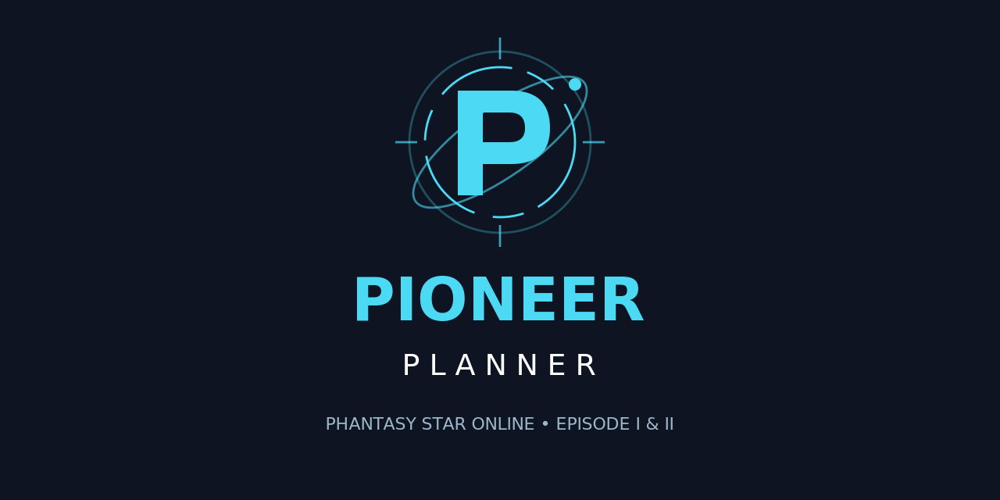
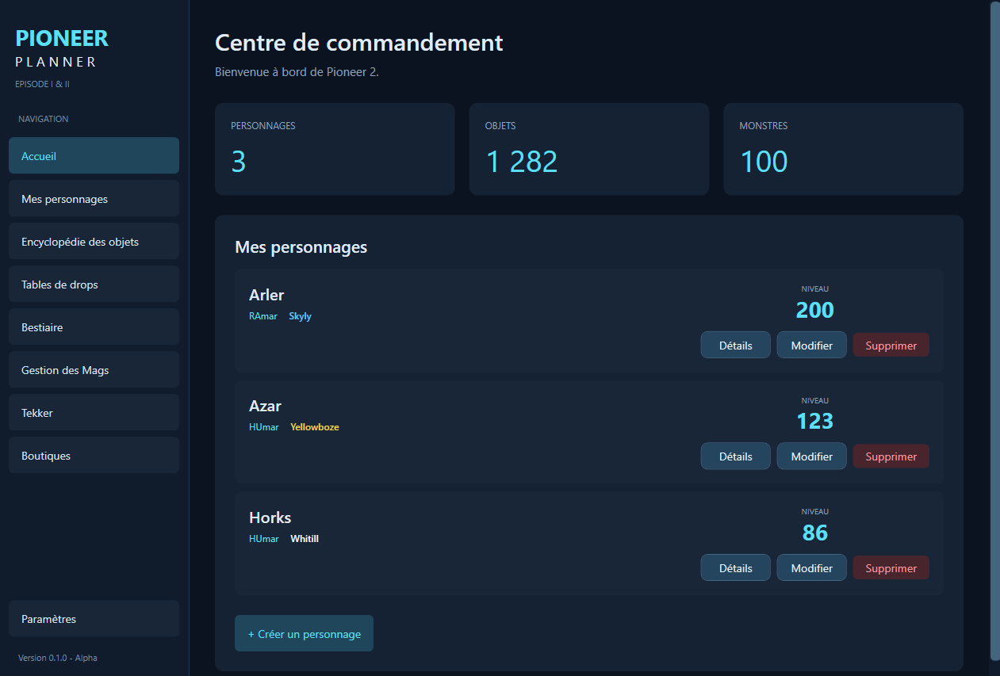
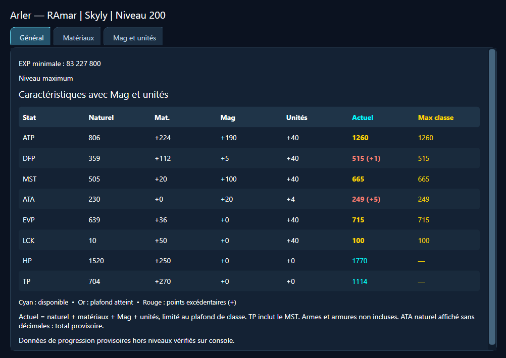
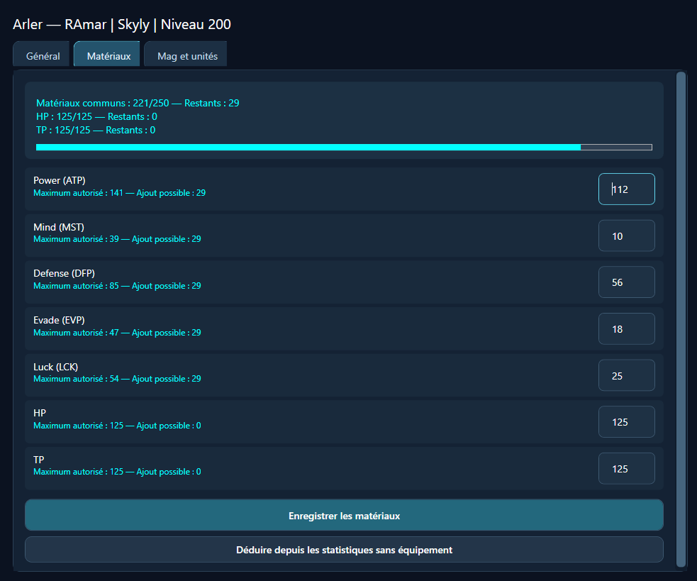
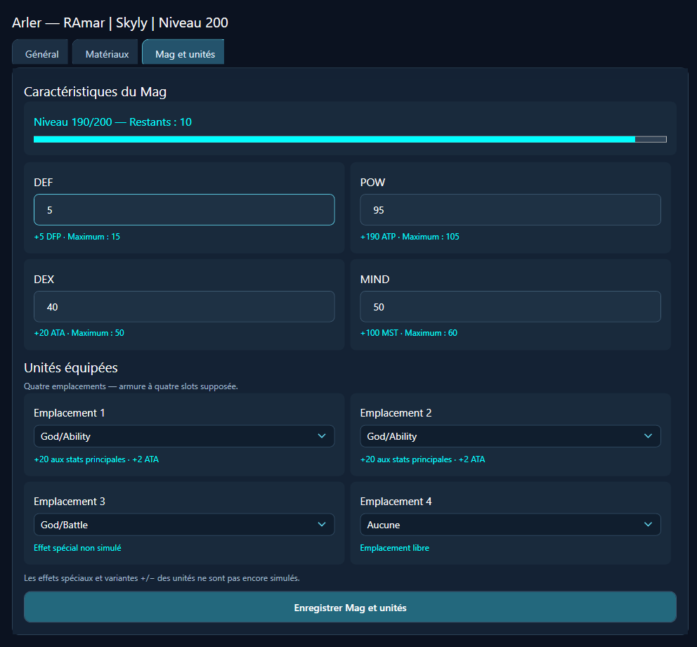

Outil gratuit de planification de personnages pour **Phantasy Star Online Episode I & II**.

PioneerPlanner est un projet communautaire indépendant conçu pour faciliter la gestion et l’optimisation des personnages.

## Fonctionnalités — v0.1.0 Alpha

- Création et gestion de plusieurs personnages.
- Calcul des statistiques selon la classe et le niveau.
- Visualisation des plafonds et des points excédentaires.
- Gestion des matériaux et de leurs limites.
- Déduction des matériaux depuis les statistiques sans équipement.
- Simulation manuelle des statistiques du MAG.
- Gestion de quatre emplacements d’Units et de leurs bonus de statistiques.

### Statistiques du personnage

### Gestion des matériaux

### MAG et Units

## Limites de la version Alpha

- Interface disponible uniquement en français.
- Certaines données de progression restent provisoires.
- Les effets spéciaux et les variantes +/− des Units ne sont pas encore simulés.
- Les armes et armures ne sont pas incluses dans le calcul actuel.
- La gestion complète des MAGs est prévue pour la v0.2.0.

## Téléchargement

La première version publique est en cours de préparation.

Version portable et autonome pour Windows 64 bits. Une fois disponible, extraire entièrement l’archive ZIP avant de lancer `PioneerPlanner.exe`.

## Feuille de route

- **v0.2.0 :** gestion des MAGs, corrections et améliorations selon les retours.
- **À venir :** traduction anglaise.

## Retours et suggestions

- [Signaler un bug](https://github.com/PioneerPlanner/PioneerPlanner/issues)
- [Discuter du projet](https://github.com/PioneerPlanner/PioneerPlanner/discussions)

## Crédits

Phantasy Star Online et les ressources originales du jeu appartiennent à SEGA et à leurs ayants droit respectifs. PioneerPlanner est un projet non officiel, gratuit et indépendant de SEGA.

---

## English overview

PioneerPlanner is a free, unofficial character planner for Phantasy Star Online Episode I & II. The current alpha includes character management, stat caps, material tracking, manual MAG stat simulation and Unit stat bonuses. Some progression data is provisional. Full MAG management is planned for v0.2.0. The interface is currently French only. Feedback is welcome!
